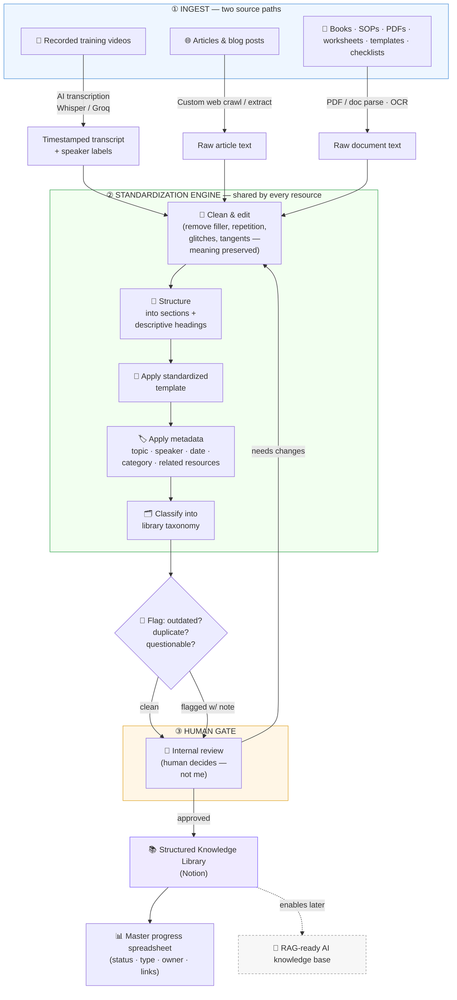

# Automation Map — Knowledge Library Pipeline

A model of how I'd run this project. The design principle: **AI does the heavy
lifting, a human owns the judgment.** Every path ends at a human review gate before
anything is called "done" — matching the posting's rule that I *flag*, but a person
*decides*.

---

## The big picture

Two ingest paths (video and text) feed **one** standardization engine, which feeds
**one** library and **one** master tracker. That single shared engine is what keeps
hundreds of resources consistent.

---

## Where the hours actually get saved

| Step | Manual way | With this pipeline |
|------|-----------|--------------------|
| Get words out of a video | Watch + type/clean by hand (hrs) | **Auto-transcribe**, then edit (mins) |
| Collect articles/blogs | Open, copy, paste, strip formatting | **Crawl/extract** in one pass |
| First-pass cleanup | Read line by line | LLM removes filler/repetition, human verifies |
| Sectioning + headings | Manual judgment each time | LLM proposes, human confirms |
| Metadata + classification | Retype fields every doc | Auto-suggested from content, human approves |
| Consistency across 100s | Drift creeps in | **One shared engine** = identical output shape |

The human is never removed from the loop — they move from *doing the grunt work* to
*approving and exercising judgment*, which is where the "do not decide whether content
should be removed" boundary lives.

---

## How this maps to tools I've already built

- **Video/audio → clean structured document** is exactly my **AI Note Taker**
  (`projects/note-taker`): Groq Whisper-large-v3 transcription with timestamped
  segments + speaker labeling → local LLM turns raw transcript into a structured,
  templated document (Summary / Action Items / Key Decisions / Notes) → stored in a
  searchable library with editable speaker metadata. The core loop of this job is
  already running code.
- **Runs locally / privately** — the same architecture keeps a client's proprietary
  training library on-machine instead of shipping it to third-party services (see
  `taglish-voice`, which is explicitly "everything runs locally, nothing uploaded").
- **Provenance & licensing discipline** — in `Helmora` I chose models/datasets by
  license and flagged non-commercial data before it could contaminate a shippable
  product. Same instinct that makes me good at the "flag outdated/duplicate/
  questionable content" responsibility.

---

## Build order if hired

1. **Lock the standard** — template + metadata schema + taxonomy + master-sheet
   columns (the contracts everything else conforms to).
2. **Wire path ① (video)** — reuse the Note Taker pipeline, tune cleanup prompts to
   their template.
3. **Wire path ② (text/crawl)** — small extractor for articles/blogs; PDF parser for
   the rest.
4. **Run the trial 10** through end-to-end, refine prompts + template from their
   feedback.
5. **Scale** — batch the hundreds, human-review-gated, tracked in the sheet.
